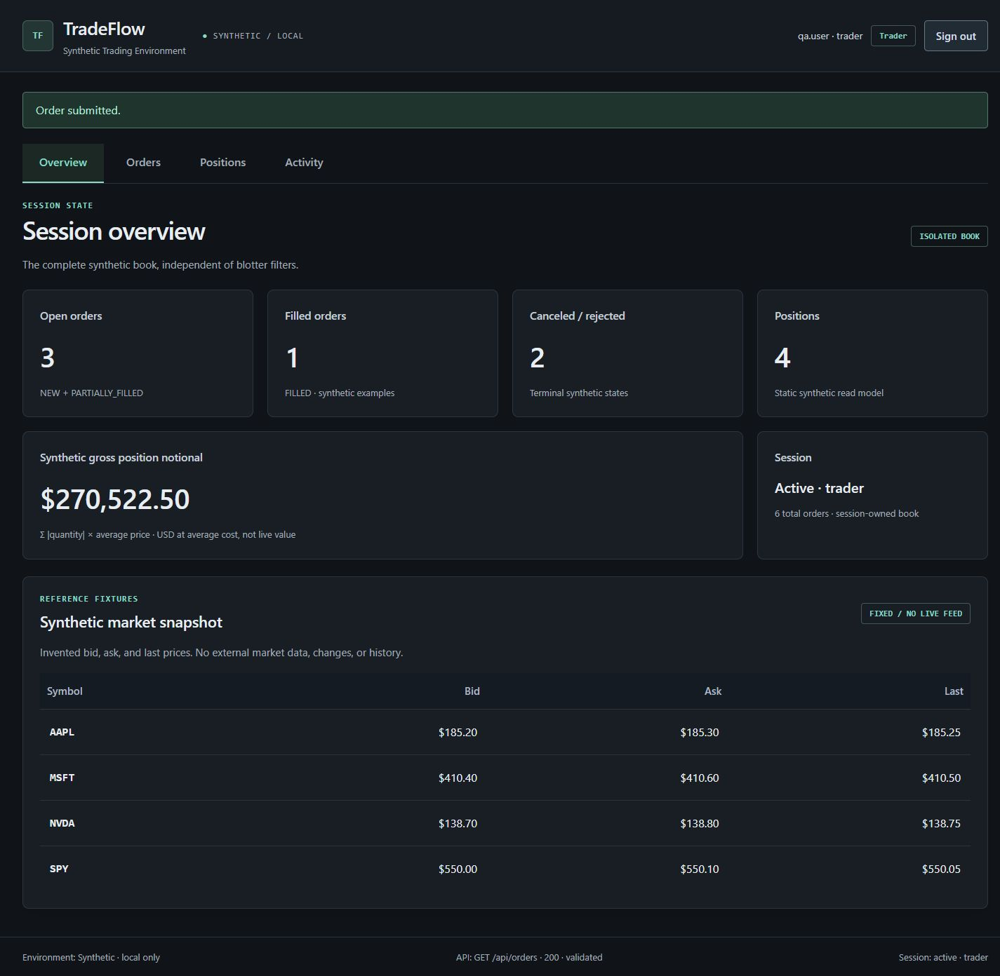
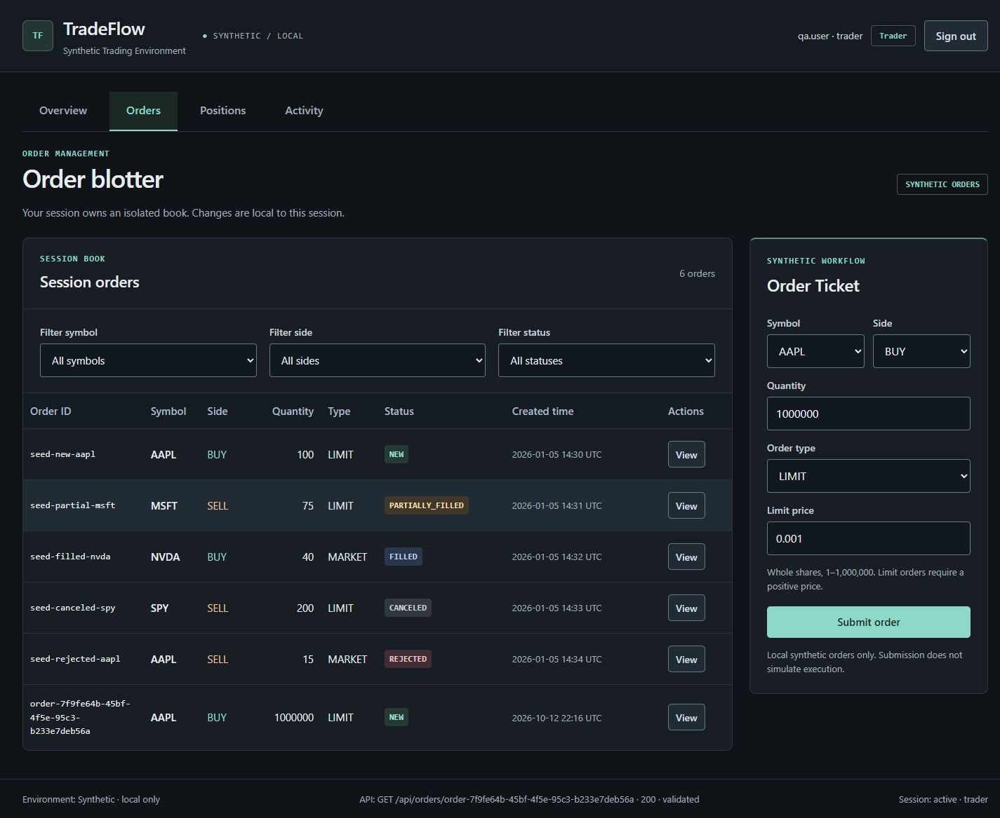
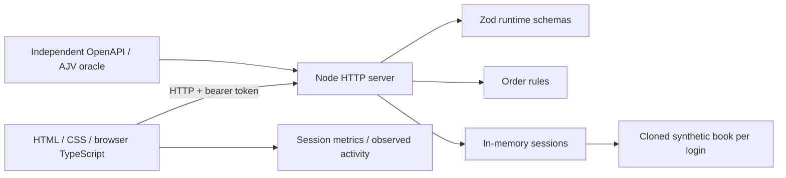
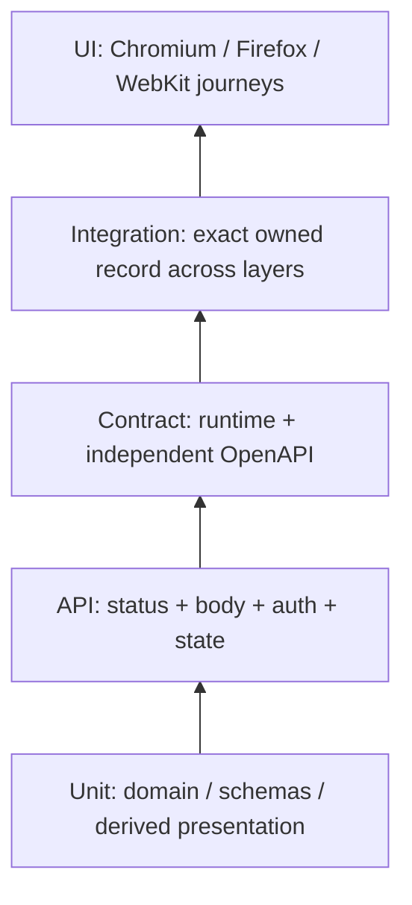

# TradeFlow

**Synthetic Institutional-Trading SDET Lab**

A synthetic trading workflow and verification lab: **Playwright/TypeScript UI, API and contract testing; opt-in PostgreSQL financial workflows; independent Python/SQL verification; and bounded offline FIX conformance.** Test-owned records, three-browser execution, runtime/OpenAPI validation and human-reviewed evidence make the engineering inspectable. This is a personal interview and learning project, not a production trading platform.

[Current source and release index](docs/CURRENT_STATE.md) · [Portfolio case study](https://farhan-shafee.com/work/tradeflow) · [Persistence CI](https://github.com/farhan-shafee/institutional-trading-sdet-lab/actions/workflows/persistence.yml?query=branch%3Amain) · [Live synthetic demo](https://tradeflow.farhan-shafee.com) · [Main CI](https://github.com/farhan-shafee/institutional-trading-sdet-lab/actions/workflows/quality.yml?query=branch%3Amain)

Every user, credential, order, position, and quote is synthetic. There are no brokerage connections, live feeds, real trades, employer systems, proprietary code, or customer data. Familiar instrument symbols do not make invented prices market data.

## Accepted source, candidate and deployed demo

| Surface                   | Exact state                                                                                                                                                                                                                                                                            |
| ------------------------- | -------------------------------------------------------------------------------------------------------------------------------------------------------------------------------------------------------------------------------------------------------------------------------------- |
| Accepted local/CI Phase 4 | [PR #38](https://github.com/farhan-shafee/institutional-trading-sdet-lab/pull/38), merge `29dd958f7f42a15841496a23ccfe594bfb864272`, tree `2fb60dd7e5e6f9c1785bc413965011a856839fd6`; all 14 main jobs passed on first attempts                                                        |
| Public Phase 4 candidate  | [Draft PR #39](https://github.com/farhan-shafee/institutional-trading-sdet-lab/pull/39); owner approved implementation/local/CI qualification; new profile, UI, exact source admission and final acceptance are tracked in the [candidate receipt](docs/PUBLIC_POSTTRADE_CANDIDATE.md) |
| Deployed public app       | `b0216022cb8ff18de904efea9279c91b3977d55f`, deployment `8d174084-7f30-40cb-a026-fa90f231c4a0`; November 6 institutional workflow                                                                                                                                                       |

Accepted Phase 4 includes zero analytics, named curves, complete-book risk, immutable corrections/full busts, fixed paper funding, gross settlement/reversal and exact FIFO/equity. Native FIX engines and their financial handoff remain local/CI. The public Phase 4 candidate adds an explicit fresh hosted profile and browser controls; it has not been accepted for deployment. [Operation and recovery](docs/PUBLIC_POSTTRADE.md).

The historical capacity finding remains `UNRESOLVED_NOT_REPRODUCED`, root cause `UNKNOWN`. Its unresolved risk was accepted for the local/CI synthetic lab only. Green reruns do not explain it. Hosted preview and production require separate decisions, including a public-risk disposition.

## November 6 public release receipt

Released **November 6, 2026**. The [public site](https://tradeflow.farhan-shafee.com) now includes fictional bond analytics, private visitor workspaces, dealer RFQ/quote acceptance, simulated executions/cancellations, an immutable synthetic execution ledger and historical reconciliation. It runs independently of the owner's computer. [Exact release receipt](docs/PUBLIC_WORKFLOW_RELEASE_2026-11-06.md).

Accepted [PR #32](https://github.com/farhan-shafee/institutional-trading-sdet-lab/pull/32) merged as `b0216022cb8ff18de904efea9279c91b3977d55f` with reviewed tree `0312dae0a6fe0e9b3e460343dec9a0ac3f7cf5ca`. [Main quality](https://github.com/farhan-shafee/institutional-trading-sdet-lab/actions/runs/42221089925) and [main persistence](https://github.com/farhan-shafee/institutional-trading-sdet-lab/actions/runs/42221090065) passed all eight checks on first attempts. Both PostgreSQL runs passed 455/455 with zero failures/cancellations/skips and retained capacity zero.

The deployed application reached Railway SUCCESS at that exact source. Chromium, Firefox and WebKit passed the real public-domain journey, including exact financial values, genuine clean source provenance, viewer/cross-visitor denials, reload and 320 px layout. The dedicated PostgreSQL 17.10/TLS database passed its authorized restart, role/schema/identity and financial-record preservation checks.

Public access lasts only for the original synthetic session (at most 30 minutes from login), logout or app restart; there is no public recovery. Workspace writes last 30 minutes; records become cleanup-eligible after 60 minutes, subject to protected leases and failure rules. Local durable ownership is unchanged.

That November 6 release's qualification passed 994 Node units, 230 baseline/460 repeated API/browser cases, two 455-case PostgreSQL runs, 99/198 workstation cases, the native public image and the bounded interview journey. These are distinct command categories, not availability, sustained-load or interoperability guarantees. Earlier Phase 3C0 and interview acceptances remain historical checkpoints in [CURRENT_STATE.md](docs/CURRENT_STATE.md).

Sign in with the fake trader/viewer credentials below. The main site is the hosted demonstration; the local interview launcher remains a separate reproducible rehearsal/verification path. Local workflow activation still defaults OFF. Later accepted source adds bounded local/CI FIX engines, socket transport and retained session recovery. Real peer interoperability remains outside the demonstrated scope.

## Institutional SDET interview rehearsal

The [institutional walkthrough](docs/INTERVIEW_DEMO.md), [Linux/WSL setup and cleanup](docs/INTERVIEW_SETUP.md), [Tradeweb requirement matrix](docs/TRADEWEB_SDET_MATRIX.md) and [study guide](docs/INTERVIEW_STUDY_GUIDE.md) distinguish actual UI, API, native and offline capabilities. The rehearsal was accepted in PR #31. Its merge did not deploy the public application.

After the documented Node 24/Python/Docker/browser setup:

```sh
npm run build:ui
npm run interview:verify
# Optional graphical rehearsal, outside CI; Resume Inspector checkpoints, then finish for cleanup.
npm run interview:demo
```

The bounded verification runs the actual workflow in a fresh descriptor-owned PostgreSQL instance and Chromium, with private browser captures disabled. Interactive debugging is not an acceptance result. [The setup guide](docs/INTERVIEW_SETUP.md) explains interruption/recovery and the separate complete gate commands.

## Hosted public institutional workflow

The hosted profile lets a visitor sign in with fake credentials, start one private workspace, calculate bond analytics, request/accept invented dealer quotations, simulate execution/cancellation, and inspect the ledger and reconciliation. All ownership material stays server-side. The viewer remains read-only. Public access ends with the original session, logout or restart; records become cleanup-eligible after 60 minutes under the reviewed public policy. Existing local durable ownership and financial/FIX contracts remain unchanged.

```sh
# Linux/WSL, Node 24, Python, Docker and installed Playwright browsers:
npm run test:public-demo
```

This builds and verifies the real dedicated PostgreSQL 17.10/TLS image, API/ownership/failure cases and baseline/repeated three-browser workflows, then removes only proven owned test resources. It is mandatory in CI. [Public workflow operation](docs/PUBLIC_WORKFLOW.md) describes configuration, private preparation journals, retention, certificate operation, hosted rehearsal and future owner-approved releases. A local test run does not publish the website.

## Fixed-income analytics in the accepted source

An additive, read-only analytics panel calculates fictional USD regular-coupon bonds: schedules, Actual/Actual ICMA versus US30/360 accrued interest, clean/dirty price, inverse yield, duration, convexity and dollar DV01. See the [complete financial contract](docs/FIXED_INCOME_CONVENTIONS.md). This analytics panel is read-only. The separate opt-in workflows below implement synthetic RFQ, executions, persistence and FIX application; the reviewed public profile exposes these institutional workflows. Curves and settlement remain outside this analytics contract.

Open **Fixed-income analytics** after signing in; supply a yield **or** a clean price. Both synthetic roles may calculate. Existing four-tab keyboard navigation and session-owned equity books are retained.

```sh
npm run test:financial
```

Requires Python3.12+ (`python3` on Unix, `python` on Windows; `PYTHON` can name another interpreter). The standard-library [independent oracle](verification/python/README.md) checks literal goldens and actual HTTP output from an owned ephemeral loopback server. The Python oracle does not inspect/import TypeScript financial code. The gate is also part of `validate` and CI.

## Run locally

The optional local PostgreSQL workflow defaults OFF. Main includes synthetic dealer RFQ acceptance, controlled order/execution/cancel workflows, historical reconciliation and an explicitly opted-in FIX application SDK. Use the [current source/capability map](docs/CURRENT_STATE.md) and its guides for ownership, recovery, exact prices, role boundaries and owned-instance prerequisites. Ordinary equities-only development needs no database; the released public institutional profile uses its dedicated database. `npm run test:postgres` and `npm run test:workflow-browser` are real PostgreSQL gates; they do not target a hosted database.

Use Node.js 24 and npm. From the repository root:

```sh
npm ci
npm run browsers:install
npm start
```

Open [TradeFlow](http://127.0.0.1:3000).

| Role   | Username    | Public synthetic password | Permissions                             |
| ------ | ----------- | ------------------------- | --------------------------------------- |
| Trader | `qa.user`   | `Password123!`            | Inspect, submit, cancel eligible orders |
| Viewer | `qa.viewer` | `Password123!`            | Read only; API mutations return 403     |

Each login creates an isolated order book. **Stop the manual server with Ctrl+C before tests.** Playwright starts its own server on port 3000 with `reuseExistingServer: false`; a stale manual process cannot supply results.

Public hosting (November 6 release): Railway runs the pinned native Node.js app and dedicated PostgreSQL database behind the existing cloudflared service and [canonical Cloudflare hostname](https://tradeflow.farhan-shafee.com). The public demo does not depend on the owner's computer. Equities books and authentication sessions reset on app restart; institutional records have separately bounded database retention and cannot be recovered by a new public session. See [production operation](docs/RAILWAY_PRODUCTION.md) and the [observed release receipt](docs/PUBLIC_WORKFLOW_RELEASE_2026-11-06.md).

```sh
npm run validate
npm test -- --repeat-each=2
npm run report
```

## The default equities workstation

Orders is the default view. Four lightweight, keyboard-accessible tabs keep the product small:

| View      | What it demonstrates                                                                                                                             |
| --------- | ------------------------------------------------------------------------------------------------------------------------------------------------ |
| Overview  | Full-session order counts, static position count, and explicitly synthetic gross position notional at average cost; filters do not change totals |
| Orders    | Server-side filters, MARKET/LIMIT ticket, exact-record details, and eligible cancellation; viewer controls remain visible and disabled           |
| Positions | Fixed symbol, quantity, and average-price read model; order submission does not imply a fill                                                     |
| Activity  | Actions observed by this browser in its current session, cleared on logout/reload; no durable or enterprise audit-log claim                      |

The four-symbol snapshot contains fixed synthetic bid/ask/last values. Details show the known creation timestamp and current API status, not invented exchange events or transition timestamps. The footer reports observed API responses and session state, not infrastructure health monitoring.

Actual local browser captures, with synthetic data:





Additional captures: [1440px exact-record details](docs/screenshots/premium/tradeflow-details-1440.jpg), [768px orders with a created UUID, maximum quantity, and sub-cent LIMIT price](docs/screenshots/premium/tradeflow-orders-768.jpg), [1024px read-only viewer](docs/screenshots/premium/tradeflow-viewer-1024.jpg), [positions](docs/screenshots/premium/tradeflow-positions-1024.jpg), and [browser activity](docs/screenshots/premium/tradeflow-activity-1024.jpg). These are observed renders, not generated mockups or visual-regression baselines.

## Architecture and ownership

Hosted ingress is Cloudflare HTTPS → Railway cloudflared → private Railway Node.js app. The diagram below shows the equities/session path. The released institutional profile adds a dedicated PostgreSQL database over verified TLS; see the [complete production topology](docs/RAILWAY_PRODUCTION.md). This remains a bounded synthetic demonstration.



The server owns authentication, authorization, validation, and order transitions. The browser displays server state and rejects malformed responses. Presentation caches belong to a token and request version: delayed responses cannot populate a replacement session or overwrite a newer accepted mutation. Unknown/loading data differs from a validated empty book.

The fixture authenticates through the API, supplies **in-memory `storageState`** to Playwright's built-in context/page, and revokes its session during teardown. Mutable state is test scoped; a worker fixture shares only immutable health metadata. Page Objects expose actions and locators; assertions remain visible in tests.



API/contract and hosted-boundary tests run once in the browser-free `service` project. Hosted-boundary cases own separate loopback servers and injected clocks; the normal lab server remains in local mode. UI/integration tests run on all three engines. Projects define coverage; four local workers or two CI workers define concurrency. The diagram expresses responsibilities, not a promised pyramid ratio.

## Evidence

Use [CURRENT_STATE.md](docs/CURRENT_STATE.md) for the accepted Phase 3C0 checkpoint, both main workflows, database/workstation evidence and public-demo boundary. Counts below are retained historical records.

<details>
<summary>Historical equities/productization evidence</summary>

`main` is the canonical portfolio branch; productization and the hostile-audit fixes are merged. Check [main-branch Actions runs](https://github.com/farhan-shafee/institutional-trading-sdet-lab/actions/workflows/quality.yml?query=branch%3Amain) for the exact latest SHA and its hosted report. The revision-specific results below retain their original provenance.

The historical productization `main` passed [hosted Ubuntu CI, run 37021360984](https://github.com/farhan-shafee/institutional-trading-sdet-lab/actions/runs/37021360984) at `4c8ddbc250a6ff638a5140170ebfc03e107bd6e3`: **34 unit checks and 205 Playwright executions**. The breakdown is **42 API, 22 contract, Chromium 47, Firefox 47, and WebKit 47**, with **44 UI + 3 integration** per browser and **0 failed, 0 flaky, 0 skipped, and 0 retries**. The downloaded [HTML artifact](https://github.com/farhan-shafee/institutional-trading-sdet-lab/actions/runs/37021360984/artifacts/11234132159) independently confirms the same SHA and results. This record was added after the validated merge revision; use the main workflow link above for subsequent revisions.

**Historical local productization evidence:** runs passed **34 unit checks, 205 normal Playwright executions, and 410 repeated executions**, with zero failed, flaky, skipped, or retried normal tests. The arithmetic is `42 API + 22 contract + 3 × (44 UI + 3 integration) = 205`. See [productization evidence](docs/PRODUCTIZATION.md) for commands, actual captures, review findings, and limits.

**Historical productization evidence:** before the completed final portfolio review, the implementation passed [hosted Ubuntu CI, run 36967330696](https://github.com/farhan-shafee/institutional-trading-sdet-lab/actions/runs/36967330696) at `62587a444e51428481ef4293a45bf970a82a4886`: **34 unit checks and 205 Playwright executions**. Its downloaded [HTML artifact](https://github.com/farhan-shafee/institutional-trading-sdet-lab/actions/runs/36967330696/artifacts/11210666114) independently confirms all three browsers and zero failed, flaky, skipped, or retried tests. This evidence belongs to that historical source revision and was recorded afterward.

**Historical audited baseline:** [hosted Ubuntu CI, run 36959822791](https://github.com/farhan-shafee/institutional-trading-sdet-lab/actions/runs/36959822791) passed at `f7f2f108576fd5d940f4a9649519d24be9ecb778`: **31 unit checks and 184 Playwright executions**, with zero failed, flaky, skipped, or retried tests. This historical run does not validate later changes.

CI installs the lockfile and Linux browser dependencies, then gates full and production dependency audits, TypeScript, lint, formatting, OpenAPI, workflow structure, units, and the normal suite. `failOnFlakyTests` rejects a test that passes only on retry. HTML reports retain for **14 days**; conditional failure evidence retains for **7 days**. Normal authenticated suites disable traces to keep bearer headers and browser auth state out of published artifacts. A green run skips the failure upload and does not prove that path. Local failure demos independently produce actual traces, screenshots, videos, and JSON.

The deployment-readiness changes add 20 unit checks and six browser-free hosted-boundary scenarios: **54 units and 211 Playwright executions**, or **422 with repeat-each=2**. The browser baseline remains **44 UI + 3 integration per engine**. CI also builds the production artifact and verifies a separate production-only installation over loopback. These counts extend the revision-specific historical evidence above; current results belong to their exact Actions run.

Historical evidence remains in [validation](docs/VALIDATION.md), the [hostile audit](docs/AUDIT.md), and the [delivery report](docs/DELIVERY_REPORT.md). Counts/results belong to their revision and run.

The [October 25 dependency-maintenance record](docs/SECURITY_MAINTENANCE_2026-10-25.md) documents the compatible Zod, Undici and fast-uri updates, blocking audit gates and release verification. The patch `265c9e0` passed [hosted CI run 40214510996](https://github.com/farhan-shafee/institutional-trading-sdet-lab/actions/runs/40214510996) with 54 unit checks and 211 Playwright executions; the local repeated suite passed 422. The exact patch was released on Railway and passed 20 public acceptance checks. The record retains the earlier local Firefox timeout and its subsequent clean runs. A dated zero-finding audit is not a guarantee against unknown or later vulnerabilities.

</details>

## Five-minute public-demo screen-share

1. Sign in as trader. Show the synthetic label, Overview, Orders, Positions, and Activity. Filter AAPL; explain why Overview uses the whole book. Submit a LIMIT order, inspect its exact ID, then cancel. Activity records observed actions; positions remain static.
2. Sign out and use `qa.viewer`. Show visible disabled controls and the API 403 regression. Stop the manual server.
3. Open `playwright.config.ts` and `tests/fixtures/tradeflow.fixture.ts`: explain projects versus workers, session cloning, fixture scope, teardown, and in-memory storage state.
4. Show an exact-ID integration test and passing malformed-HTTP-200 regression. Run a small API case and show a prepared intentional-failure trace:

   ```sh
   npm run test:api -- --grep "filled"
   npm run demo:failure
   npm run report:demo
   ```

   The demo deliberately exits **1**, with separate `demo-results/` and `demo-report/`; it never replaces the normal report.

5. Show the exact hosted run, finite artifacts, and [AI review workflow](docs/AI_ASSISTED_TESTING.md). AI proposes/analyzes; humans accept behavior changes and deterministic gates decide results.

Use prepared evidence if a live command exceeds the screen-share time; state when it ran. See the [detailed demo](docs/INTERVIEW_DEMO.md) and [study questions](docs/INTERVIEW_QUESTIONS.md).

## Commands and code to inspect

| Command                                                       | Purpose                                                                         |
| ------------------------------------------------------------- | ------------------------------------------------------------------------------- |
| `npm run typecheck` / `npm run lint` / `npm run format:check` | Static and formatting gates                                                     |
| `npm run contract:validate` / `npm run workflow:validate`     | Specification/workflow-structure gates; not hosted execution                    |
| `npm run test:unit`                                           | Domain, schema, and presentation checks                                         |
| `npm test`                                                    | Normal API/contract/UI/integration suite                                        |
| `npm audit` / `npm audit --omit=dev`                          | Full and runtime-only known-advisory gates                                      |
| `npm run validate`                                            | Dependency audits, static/specification/unit checks and normal Playwright gates |
| `npm test -- --repeat-each=2`                                 | Repeated normal execution to expose intermittency                               |
| `npm run demo:failure` / `npm run demo:contract`              | Deliberate failures; expected exit 1                                            |
| `npm run report` / `npm run report:demo`                      | Normal / most recent demo HTML report                                           |
| `npm run perf:smoke`                                          | Optional local API signal; excluded from deterministic CI                       |

Start with [test strategy](docs/TEST_STRATEGY.md), [fixtures](docs/FIXTURES.md), [parallelism](docs/PARALLELISM_AND_FLAKINESS.md), [API/contracts](docs/API_AND_CONTRACT_TESTING.md), [failure triage](docs/TRACING_AND_FAILURE_TRIAGE.md), and [CI](docs/CI_CD.md). First code files to study: `playwright.config.ts`, `tests/fixtures/tradeflow.fixture.ts`, `tests/ui/productization.spec.ts`, `tests/api/orders.spec.ts`, and `tests/contract/responses.spec.ts`.

## Deliberate limits and publication

The default equities slice uses process-local session books; restarting it deletes those sessions/orders. The separately opted-in local PostgreSQL workflow retains controlled synthetic RFQ, execution and reconciliation records. Public-demo positions are static and Activity is browser-observed. There is no live venue, matching engine, settlement, real-money P&L, production identity, capacity or regulated-trading claim. Cross-browser/repeated results establish evidence for checked scenarios, not an absence-of-defects guarantee.

Demo credentials are intentionally public synthetic fixtures. Reports, browser auth files, environment files, logs, and machine artifacts are ignored. `package.json` keeps `"private": true` to prevent accidental npm publication; GitHub repository visibility is controlled separately in repository settings.

## License

This project is licensed under the [MIT License](LICENSE).

Implemented Phase 2D: [durable reconciliation and exception investigation](docs/FIXED_INCOME_RECONCILIATION.md), opt-in local/ephemeral CI only. Completed results are historical snapshot assessments; no financial repair or production rollout is included.

Implemented Phase 3A: [bounded FIX4.4 codec and bilateral profile](docs/FIX44_PROFILE.md), standalone synthetic bytes only. No FIX financial adapter, transport, session engine or deployment. `npm run test:fix44` independently checks raw bytes and the pinned base FIX4.4 dictionary.

Phase 3C0 is implemented: [offline FIX session contract and transcript conformance](docs/FIX44_SESSION.md). [Later roadmap entries](docs/plans/PHASE3C.md) remain proposed; no runtime FIX session engine or peer-interoperability release is implied.
