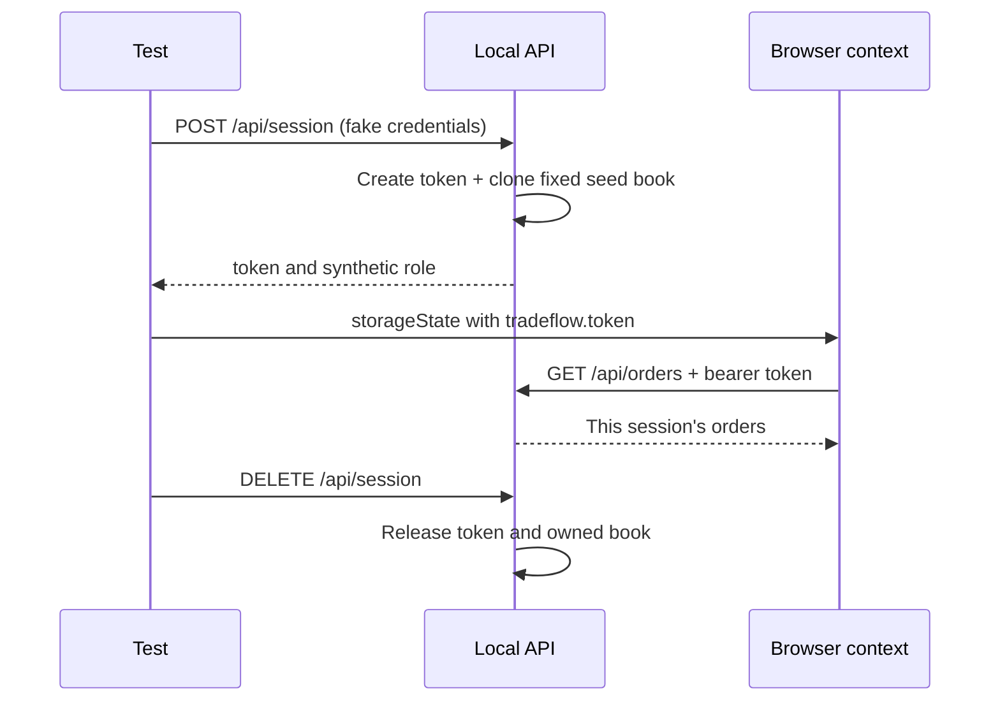

# Architecture

TradeFlow Lab has one process and one explicit purpose: make test engineering understandable. Node 24 runs a lightweight native HTTP server; `tsx` runs server TypeScript; esbuild bundles browser TypeScript. Semantic HTML/CSS avoids a framework lifecycle that contributes little to the demonstration.

## Hosted deployment

The public workstation runs on Railway: Cloudflare HTTPS → separate Railway cloudflared tunnel → private Railway Node.js app. It is independent of the owner's computer. One process owns ephemeral session books; there is no database, persistent volume or durable backup. Restarts reset synthetic state. The app source remains pinned to a reviewed release; see [current production operations](RAILWAY_PRODUCTION.md) for source identity, health, resource and security boundaries.

## Boundaries

| Area                     | Responsibility                                                       | Reason                                                   |
| ------------------------ | -------------------------------------------------------------------- | -------------------------------------------------------- |
| `app/domain/`            | Types, runtime schemas, validation, seeded values, order rules       | Pure rules can be tested without HTTP or a browser       |
| `app/server/`            | Routing, authentication, authorization, response mapping, sessions   | Status codes and resource ownership have one owner       |
| `app/public/`            | Four-view shell, order actions, derived metrics and browser activity | Thin client displays server truth                        |
| `contracts/openapi.yaml` | Published request/response/status vocabulary                         | Consumers need a wire contract independent of TypeScript |
| `tests/fixtures/`        | Lifecycle and ownership of test resources                            | Setup and cleanup compose without duplicated hooks       |
| `pages/`                 | Focused locators and user actions                                    | Tests retain their intent and assertions                 |
| `test-data/`             | Public reference constants and pure order factory                    | Generated inputs are explicit and reproducible           |
| `scripts/`               | Contract validation and optional performance smoke                   | Gates remain separate from app behavior                  |

## Session-owned state

Every login, including the same username, receives a new token and a separate cloned book. `qa.user` can submit and cancel; `qa.viewer` can read and receives `403` on mutations. Known seed IDs are reused safely because they belong to distinct books. Unknown IDs in another session return `404` rather than exposing that session's records.

Tests keep storage state in memory. The browser uses localStorage key `tradeflow.token`; request clients send the equivalent bearer token. One integration test shares its own session between those two interfaces, proving a cross-layer workflow without sharing it with another test.

## Observable rules

The supported symbols are AAPL, MSFT, NVDA, and SPY. Quantity is a positive integer at most 1,000,000. A LIMIT order requires a positive finite `limitPrice`; a MARKET order rejects a supplied price. Only NEW and PARTIALLY_FILLED orders can cancel. A successful cancellation changes status to CANCELED; an ineligible repeat receives `409`.

The seed book includes NEW, PARTIALLY_FILLED, FILLED, CANCELED, and REJECTED records with fixed timestamps. New records receive unique IDs and creation timestamps. Positions are a fixed synthetic view; order submission does not imply a fill or change position balances.

## Browser presentation

Overview, Orders, Positions, and Activity are lightweight tab panels; Orders remains the initial view. Overview counts use a complete book rather than the filtered blotter. Open means NEW or PARTIALLY_FILLED; closed combines CANCELED and REJECTED. Synthetic gross position notional is `sum(abs(quantity) * averagePrice)`, an average-cost basis with no live valuation or P&L claim. The market snapshot is a fixed four-symbol client fixture.

Complete-book and position caches are token owned. Request versions reject older reads; an accepted mutation invalidates earlier book reads and updates a known complete cache before a later refresh. An unknown first read remains unavailable, not zero. Navigation preserves filters and selected details. Logout/token replacement clears cached positions, book data, ticket drafts, and browser activity.

Activity records actions observed in the current browser document, including accepted mutations even if the subsequent refresh fails. Its timestamps are browser observation times; it is bounded, nonpersistent, and not an authoritative server audit trail. Reload begins a new observation list. Order lifecycle displays only the known creation time and current state because the API supplies no transition-event history. Viewer controls are visible and disabled, while server-side 403 checks remain the authorization boundary.

## Choices an interviewer should challenge

The in-memory domain model avoids database migrations and durable-store dependencies; local development needs no application container. It does not model distributed execution, failover, durable storage, risk checks, fills, exchange connectivity, or reconciliation. LocalStorage and public fake passwords demonstrate reusable auth setup and role checks; they are not a production identity design.

Zod provides executable runtime validation. OpenAPI supplies a second independently interpreted contract, so a TypeScript type shared by client and server cannot be the only oracle. Domain tests, service tests, and browser tests catch different failures. See [the layer strategy](TEST_STRATEGY.md) for what each gate proves.

## Runtime and maintenance dependency boundary

Zod is the sole production npm dependency and is also bundled into browser validation. Swagger/OpenAPI reference parsing and AJV belong to development validation; their Undici and fast-uri dependencies are not installed in the clean production-only smoke. The [October 25 maintenance record](SECURITY_MAINTENANCE_2026-10-25.md) binds the compatible patch versions, blocking full/production audits, actual CI and deployed source. This update preserves application contracts, per-session state and the existing Railway/Cloudflare Tunnel topology.
