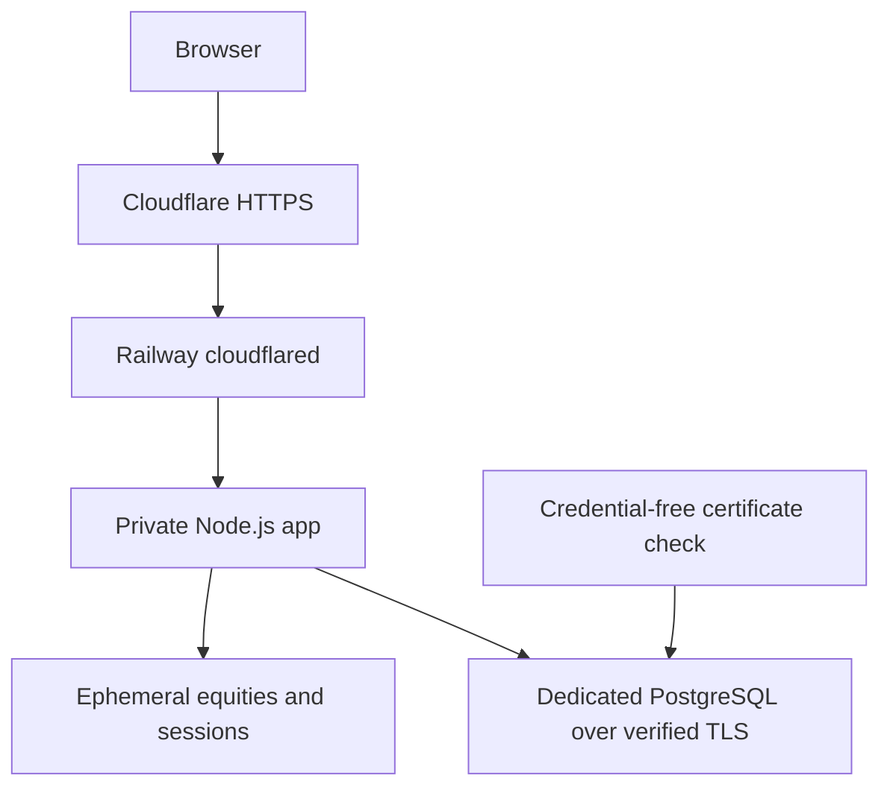

# TradeFlow Railway production topology

Reviewed **November 6, 2026** after the owner applied the institutional-workflow release. [Live synthetic workstation](https://tradeflow.farhan-shafee.com) · [Health](https://tradeflow.farhan-shafee.com/health) · [Exact release receipt](PUBLIC_WORKFLOW_RELEASE_2026-11-06.md).

The public site runs independently of the owner's computer. Cloudflare HTTPS enters through the existing separate Railway cloudflared service. The private Node.js app now uses a dedicated PostgreSQL 17.10 database for the short-lived public institutional workflow.

## Source and runtime

| Item                  | Observed configuration                                                                                               |
| --------------------- | -------------------------------------------------------------------------------------------------------------------- |
| App source            | Pinned `b0216022cb8ff18de904efea9279c91b3977d55f`, accepted PR #32                                                   |
| App deployment        | `8d174084-7f30-40cb-a026-fa90f231c4a0`, SUCCESS at November 6, 08:49:00 EST                                          |
| Build/start           | Native `deployment/application/Dockerfile`, Node 24, genuine clean Git checkout; `node dist/app/server/index.js`     |
| App health/ingress    | `/health`, private port 8080, existing tunnel; no new public Railway app domain                                      |
| App bounds            | One sfo replica, 0.5 vCPU / 500 MB ceiling, 90-second readiness timeout                                              |
| Database              | Dedicated PostgreSQL 17.10, private `production-postgres.railway.internal`; no public database domain or TCP proxy   |
| Persistence           | Dedicated 512 MB volume at `/var/lib/postgresql/data`; one replica, 0.5 vCPU / 500 MB ceiling                        |
| Runtime roles         | Separate restricted app/reconciler/maintenance credentials and public CA; admin/migrator credentials absent from app |
| Existing site monitor | Existing website/health function every 15 minutes, unchanged                                                         |
| Certificate monitor   | Separate Bun 1.4.4 function, daily `0 14 * * *` UTC, restart NEVER, 0.25 vCPU / 250 MB                               |

The exact release passed all eight main checks on first attempts and real Chromium/Firefox/WebKit workflows. A documentation push does not deploy a new app revision: this release stays explicitly pinned. Consult actual deployment metadata and the dated receipt before making later-release claims.

## Public behavior and security boundaries

The equities book and authentication sessions remain process-local and isolated per login. The distinct public institutional profile supplies server-owned private workspace bootstrap, fictional bond analytics, RFQ/quote acceptance, simulated order/execution/cancellation, an immutable synthetic execution ledger and historical independent reconciliation.

All users, credentials, quotes, orders and executions are fake fixtures. Viewer mutations return 403; a valid visitor session does not authorize another visitor's records. Ownership material remains server-side. Native durable recovery/bootstrap routes are unavailable publicly. Access ends with the original session, logout or app restart.

Workspace writes last 30 minutes; records become cleanup-eligible after 60 minutes. Retention is not post-session access. Cleanup preserves active leases and existing complete-graph rules; infrastructure failure can delay it. Retained capacity is bounded at 50. The [profile contract](PUBLIC_WORKFLOW.md) distinguishes this policy from unchanged local durable ownership.

SQL statement/lock/transaction bounds remain 1500 ms / 750 ms / five seconds. App, reconciler and maintenance use verified certificate/hostname TLS and distinct least-privilege roles. The eight base migrations and financial contracts are unchanged.

TLS terminates at Cloudflare; the tunnel's private app hop is HTTP. Keep the app private with this topology. Do not introduce a direct public app domain and assume Cloudflare controls cover it. Never copy tunnel tokens, database URLs, passwords, private CA keys or visitor bearer tokens into source, logs or browser captures.

## Operation and monitoring

Railway ingress metrics can be empty because public requests enter through the tunnel; they do not establish availability. Read public home/health, active deployments, replica state and bounded logs separately. `/health` is not a full persistence or capacity guarantee.

The certificate monitor contains only the actual private hostname and public CA. It sends an eight-byte SSLRequest, requires exactly the PostgreSQL S response, validates TLS/hostname and closes before authentication or SQL. It has no database password, public endpoint or persistent volume. It warns/exits nonzero at 35 or fewer days remaining; notification delivery is not demonstrated merely by a log entry.

The observed leaf expires February 4, 2027, 07:56:18 EST. The image renews on database startup when fewer than 30 days remain and preserves the CA. Schedule owner-controlled renewal/restart and verify it; this is not unattended renewal or high availability. At the initial post-deploy check, the production function was ready for its first scheduled execution. The [receipt](PUBLIC_WORKFLOW_RELEASE_2026-11-06.md) distinguishes deployed configuration, observed probe execution and scheduled execution.

Before activation, an authorized database restart preserved the volume, financial fixture, migrations, roles, database identity and certificates. After activation, all three runtime roles independently verified TLS 1.3 from the new app container. Application restart still loses public sessions even when database records survive. No durable public session recovery or off-volume backup/recovery guarantee is claimed for these expiring synthetic graphs.

## Release acceptance and rollback

For a future authorized release:

1. Qualify the reviewed exact source through unchanged gates. Use immutable run/source references.
2. Preserve current app source, artifact and complete configuration before staging changes. Prepare fresh credentials only for a newly approved empty database.
3. Check only intended staged resources, require terminal SUCCESS, verify source/tree/CLEAN provenance, runtime roles/TLS and the real public-domain visitor workflows.
4. Record exact financial values, viewer/cross-visitor denials, reload/session boundaries, cleanup, limitations and resource state. Finite checks are not sustained-load or uptime evidence.
5. Synchronize README/current-state/portfolio from the observed release.

The prior equities source `265c9e0ed1fdc528193cd474d966513decd03d3b` and deployment `30ca206b-765b-4fe5-ad22-50a1f2d02aec` are retained with the exact old two-variable app configuration. Rollback restores the old source and Railpack builder, clears the Dockerfile setting with actual JSON null and removes all five new `TRADEFLOW_PUBLIC_DEMO*` variables. Setting activation off alone is insufficient. Preserve the new database, volume, journals and evidence; do not reset/downgrade its schema or rotate passwords as a rollback shortcut. The existing tunnel and unrelated monitors remain unchanged.

The preview proved rebuilding the exact older source and restoring the candidate; it did not prove redeployment of the exact retained production artifact. Preserve that distinction. Historical [October 25 dependency maintenance](SECURITY_MAINTENANCE_2026-10-25.md) and the [pre-rollout topology at b021602](https://github.com/farhan-shafee/institutional-trading-sdet-lab/blob/b0216022cb8ff18de904efea9279c91b3977d55f/docs/RAILWAY_PRODUCTION.md) retain their original evidence.

There is no real broker/exchange, live feed, settlement, real-money P&L or production-trading guarantee. FIX remains bounded application tooling and offline conformance; no running session engine, transport or independent peer was added.
