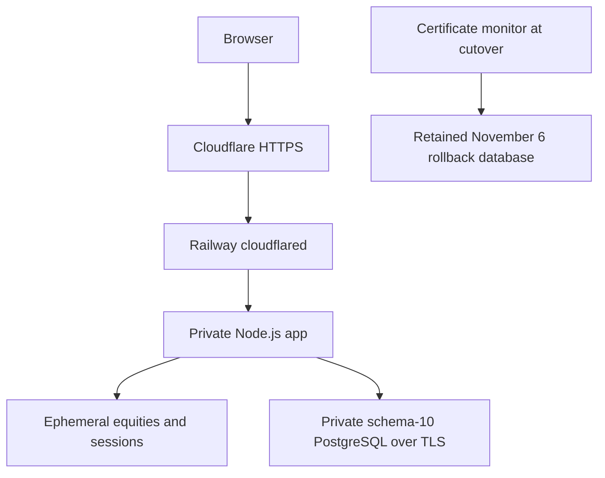

# TradeFlow Railway production topology

Reviewed **November 21, 2026** after the verified Phase 4 cutover. [Public workstation](https://tradeflow.farhan-shafee.com/) · [Health endpoint](https://tradeflow.farhan-shafee.com/health) · [Live verification](PUBLIC_POSTTRADE.md#november-21-live-verification).

Cloudflare terminates public HTTPS and sends traffic through the existing cloudflared service to the private Node.js app. The app uses the separate, dedicated schema-10 PostgreSQL instance over verified TLS. The public site runs independently of the owner's computer.

## Source and runtime

| Item                       | Observed configuration                                                                                                                                                                |
| -------------------------- | ------------------------------------------------------------------------------------------------------------------------------------------------------------------------------------- |
| App source                 | [PR #39](https://github.com/farhan-shafee/institutional-trading-sdet-lab/pull/39), pinned `20d59355285e14dc3985ee478559a6bb335db190`, tree `e3fa71fa5255bda3614e59520aa2d7ad58a75b4d` |
| App deployment             | `5a0d66e1-66ac-4150-887f-5044a013ae40`, SUCCESS on November 21 at 15:51:40 UTC                                                                                                        |
| Build and start            | `deployment/application/Dockerfile`, Node 24, `node dist/app/server/index.js`                                                                                                         |
| App readiness and ingress  | `/health`, private port 8080, 90-second readiness limit, existing Cloudflare tunnel                                                                                                   |
| App and database resources | One replica each in SFO, 0.5 vCPU and 500 MB ceiling per service                                                                                                                      |
| Database and volume        | Fresh PostgreSQL 17.10, `public-posttrade-v1` on private `production-posttrade-postgres.railway.internal`, dedicated 512 MB volume at `/var/lib/postgresql/data`                      |
| Runtime access             | Separate restricted roles for app, reconciliation and maintenance. Verified CA and hostname. Admin/migrator credentials are absent from the app.                                      |

The deployed application stays pinned to the verified commit. For source qualification see [post-merge quality](https://github.com/farhan-shafee/institutional-trading-sdet-lab/actions/runs/44877080620), [persistence](https://github.com/farhan-shafee/institutional-trading-sdet-lab/actions/runs/44877080617) and the [native public profile](https://github.com/farhan-shafee/institutional-trading-sdet-lab/actions/runs/44877080605).

## Public behavior and security boundaries

Visitors sign in with the published synthetic credentials. Each session owns an isolated workspace. The public workflow includes synthetic RFQs, order execution, paper funding, corrections and full busts, gross settlement and reversal, risk and FIFO equity/P&L. Viewer mutations return 403. A new session cannot access another visitor's workspace or recover the former session's workspace. An interrupted financial request can recover its original key while the originating session is still authorized.

Login expiry, logout or app restart ends public access. Workspace writes last 30 minutes. Records become cleanup-eligible after 60 minutes, subject to protected leases and the existing failure policy. Retained capacity is bounded at 50. SQL statement/lock/transaction bounds remain 1500 ms / 750 ms / five seconds. Original migrations 001–010 remain intact. See the [public profile and recovery rules](PUBLIC_POSTTRADE.md).

The app and both database instances use private Railway networking. The Cloudflare tunnel's private app hop is HTTP. Keep that only public entry path. Keep tunnel tokens, database URLs, passwords, private CA keys and visitor bearer tokens out of source, logs and browser captures.

## Operation and monitoring

- **Uptime.** The existing `production-monitor` checks the site and health endpoint every 15 minutes. Inspect its latest `OPS_MONITOR` result and the public health response. Follow an unexpected result with active-deployment, private database and bounded workflow checks. Public health is a server liveness check. Ingress metrics can be empty because traffic enters through the tunnel.
- **Database TLS.** The credential-free `production-certificate-monitor` was scheduled at 14:00 UTC for the retained November 6 rollback database at cutover. The November 21 private-network probe verified both databases with TLS 1.3. The active schema-10 database's leaf expires February 19, 2027 at 15:38:59 UTC. Check the latest scheduled run for both target labels before relying on daily coverage of the active database. The probe sends a PostgreSQL SSLRequest, verifies the matching CA and hostname, and closes before authentication or SQL. The scheduled job logs `CERT_MONITOR` and exits nonzero on error or at 35 or fewer days remaining. Notification delivery requires separate evidence.
- **Certificate renewal.** On startup the database image renews the leaf when fewer than 30 days remain and preserves the CA. Inspect current expiry in the monitor before any owner-authorized database restart. Recheck TLS and the live workflow afterward. Public sessions still end on app restart even when database records survive.
- **Cost.** Use Railway workspace usage and the existing soft alert and hard cap. Check both usage to date and the provider estimate for the current period. The workspace hard cap can take the demo offline if reached. [Railway cost controls](https://docs.railway.com/pricing/cost-control).

## Release acceptance and rollback

The owner accepted the unresolved historical finding for the synthetic demo with rollback on recurrence or failed required verification. Preserve first-failure evidence. The November 6 rollback target is commit `b0216022cb8ff18de904efea9279c91b3977d55f`, tree `0312dae0a6fe0e9b3e460343dec9a0ac3f7cf5ca`, deployment `8d174084-7f30-40cb-a026-fa90f231c4a0`.

1. Restore the retained November 6 deployment snapshot while it is eligible. The cutover rehearsal on the isolated new service restored the running snapshot. It showed that the saved settings for future deployments need independent restoration and verification. [Railway deployment actions](https://docs.railway.com/deployments/deployment-actions).
2. Restore the November 6 app pin and its exact saved settings from the owner-device release journal. Restore the original database targets and CA, remove the post-trade flag, and preserve the legacy database, its volume and the existing tunnel. If the retained image is unavailable, use the exact old source and original settings to rebuild and verify the release.
3. Require Railway SUCCESS and verify the original runtime source/tree, profile, original database TLS/roles and publicly accessible workflow. Preserve the new database, volume and failure evidence. Keep credentials in their private journal.
4. Record the observed result in the project docs. Future release work still requires its own reviewed source, test evidence and cutover authorization.

See the [November 6 historical receipt](PUBLIC_WORKFLOW_RELEASE_2026-11-06.md) and [public Phase 4 verification](PUBLIC_POSTTRADE.md#november-21-live-verification). TradeFlow uses invented data, paper funds and simulated settlement. Native FIX and peer conformance remain local and CI-only.
