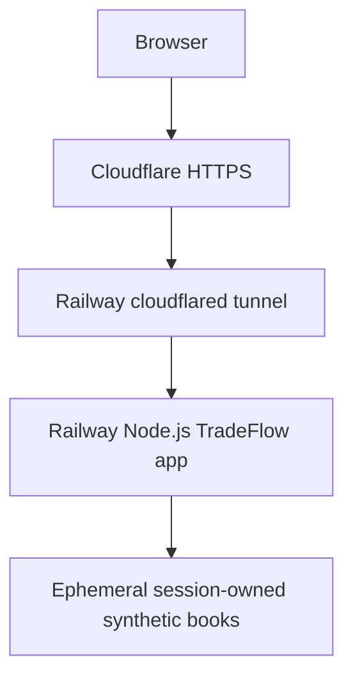

# TradeFlow Railway production topology

Reviewed October 25, 2026. [Live synthetic workstation](https://tradeflow.farhan-shafee.com) · [Health](https://tradeflow.farhan-shafee.com/health) · [Public source](https://github.com/farhan-shafee/institutional-trading-sdet-lab).

TradeFlow runs on Railway independently of the owner's computer. A separate Railway cloudflared service connects the public Cloudflare hostname to the app over the private network. It has no application database, persistent volume or backup requirement.

## Source and runtime

| Item       | Observed configuration                                                                    |
| ---------- | ----------------------------------------------------------------------------------------- |
| App source | Public repository `main`, pinned to `265c9e0ed1fdc528193cd474d966513decd03d3b`            |
| Build      | Node 24, Railpack, `npm ci --include=dev && npm run build`                                |
| Start      | `node dist/app/server/index.js`                                                           |
| Health     | `/health`                                                                                 |
| Capacity   | One sfo replica, 0.5 vCPU / 500 MB configured ceiling                                     |
| Ingress    | Separate cloudflared service; no public Railway app ingress in the reviewed configuration |
| Monitor    | Railway Function every 15 minutes, website and public health checks                       |

The October 25 compatible dependency patch `265c9e0` passed [CI run 40214510996](https://github.com/farhan-shafee/institutional-trading-sdet-lab/actions/runs/40214510996) and reached Railway SUCCESS at 2026-10-25T17:08:36.249Z (deployment `30ca206b-765b-4fe5-ad22-50a1f2d02aec`). Twenty public acceptance checks passed at 2026-10-25T17:09:14.687237+00:00, including exact served-asset hashes and isolated synthetic trader/viewer workflows. The earlier reviewed pin was `7b125f63198b0eb38a2e7140aba0d83d2e7fcdc1`. See [dependency maintenance and its evidence limits](SECURITY_MAINTENANCE_2026-10-25.md).

The app release is pinned. A documentation push to main does not itself prove that production changed revisions. Read actual deployment metadata for future releases; CI checks and runtime publication are separate facts.

The browser UI and same-origin API are served by one Node process. Each login receives an isolated cloned order book. Sessions, created orders, rate-limit counters and activity state are synthetic and ephemeral. Restarting or replacing the app discards that state and requires a fresh login; no recovery migration is appropriate.

## Public security boundaries

Only public fake fixtures are used; they are not credentials to a financial institution. Server-side role checks, ownership, request/runtime schema validation, bounded admission and hosted-mode resource caps remain authoritative. `qa.viewer` can read while mutations return 403. A valid session never authorizes another session's records.

TLS terminates at Cloudflare; the tunnel's internal hop is private application HTTP. Keep the app private when operating this tunnel topology. Do not introduce a public Railway app domain and then assume Cloudflare controls cover that bypass. Do not copy a tunnel token into documentation, Git history, logs or browser output.

The separate [historical readiness record](PUBLIC_DEPLOYMENT_READINESS.md) discusses alternative direct-ingress/TLS/Free-plan constraints. Those alternatives are not descriptions of the currently selected tunnel route. Do not repurpose another project's edge rules or change shared billing/TLS settings as a routine release.

## Monitoring and release acceptance

Railway ingress metrics can be empty because requests enter through the tunnel; that is not proof of health. Check both public endpoints and bounded app/tunnel logs. Unexpected app failures are logged with the `TradeFlow INTERNAL_ERROR` marker. Read deployment success, running/crashed replicas and CPU/RAM limits separately.

For an authorized application release:

1. Validate reviewed source with the repository's full and production dependency audits, compiler, lint, formatting, contract, unit, production-build/smoke and three-browser test gates.
2. Review the actual source pin and deploy only the approved release. Require terminal SUCCESS at that SHA for the app and a healthy tunnel.
3. Check website/health, same-origin assets/API, synthetic disclosures, login/viewer boundaries and bounded errors. Production mutation checks need an explicitly authorized synthetic scope.
4. Review resource use and availability without treating finite checks as load tolerance, immediate paging or guaranteed recovery.
5. Record the release source and observed results. Roll back only to an already reviewed hosted-safe artifact, preserving tunnel/hosted boundaries.

There is no broker, exchange connection, live market feed, matching engine, real execution, P&L, settlement or durable ledger. Incident Copilot integration remains a separately proposed feature; this hosting work does not implement it.

## Local development and dated evidence

[README](../README.md), [architecture](ARCHITECTURE.md) and [test strategy](TEST_STRATEGY.md) retain local loopback development and reproducible fixture ownership. Historical test totals are attached to their original source revisions; the latest run result must be checked before claiming a current pass. `package.json`'s `private: true` prevents npm publishing and does not make the GitHub repository private.
